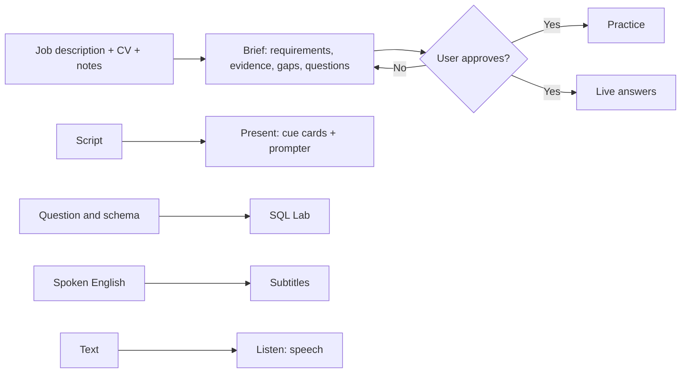
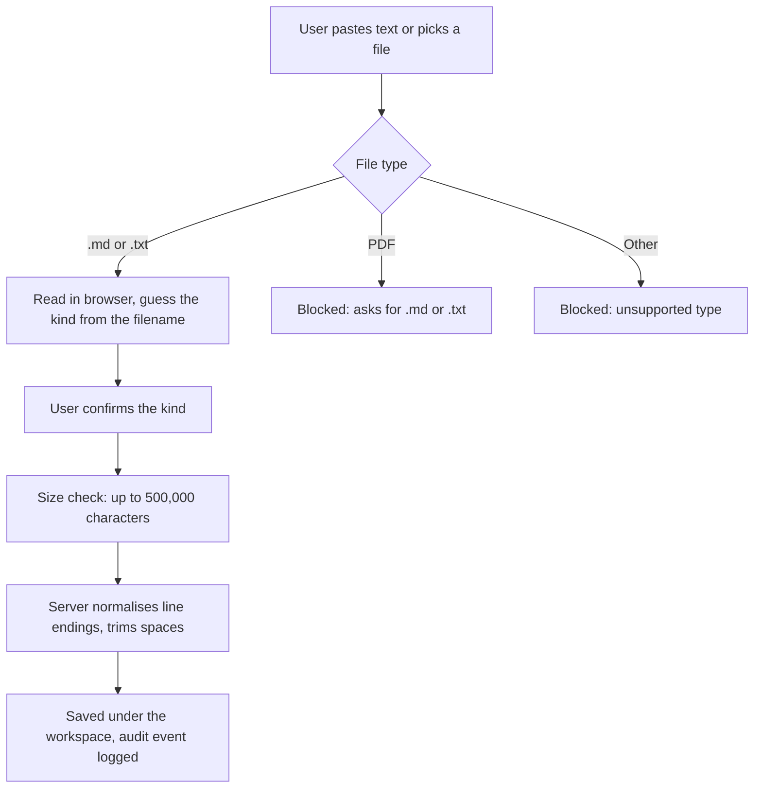
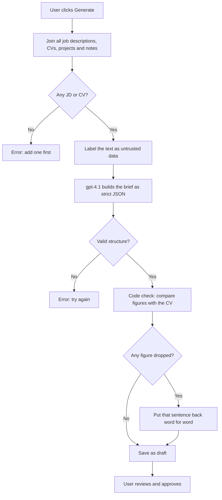
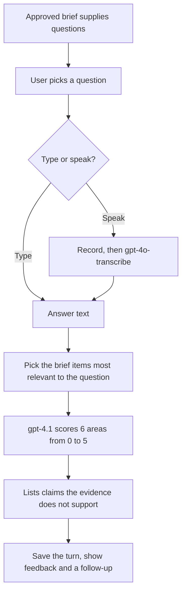
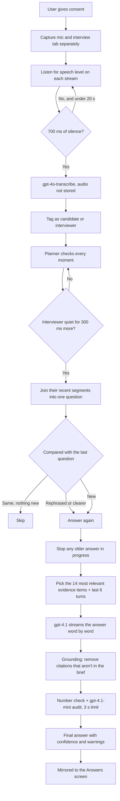
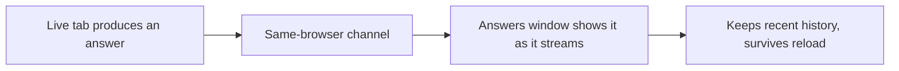
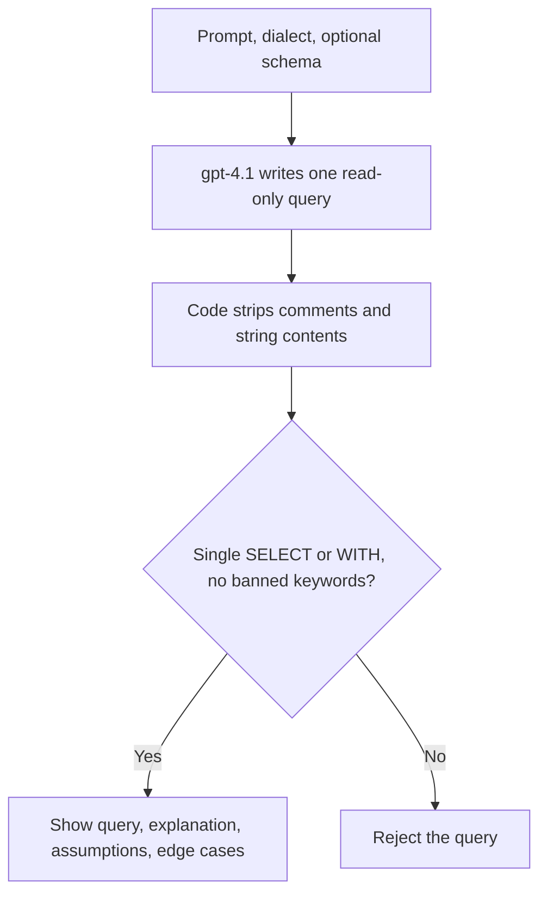
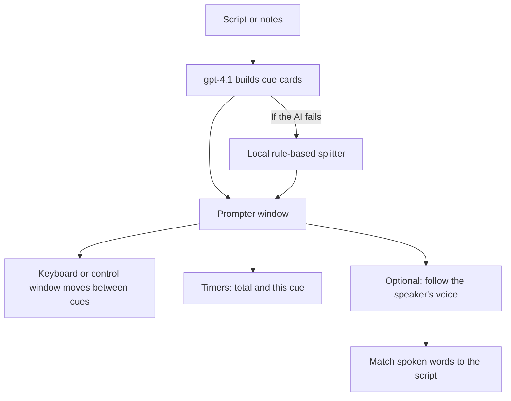
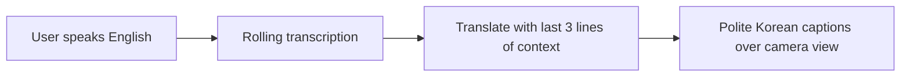
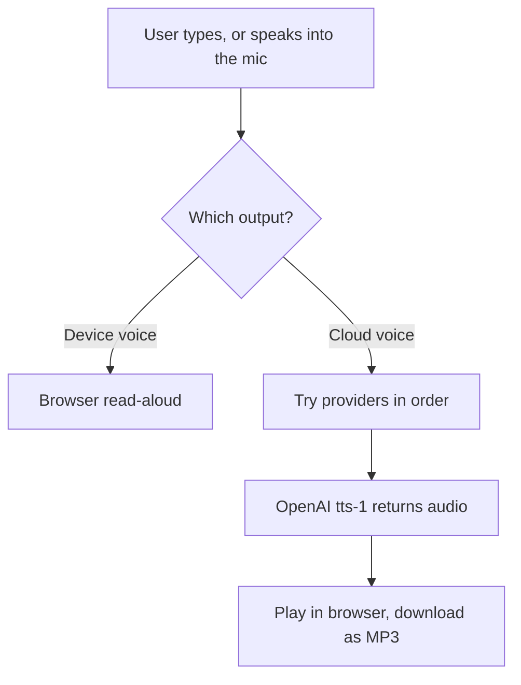

# Reasoning Map

How each feature decides what to do, step by step, and where we can make it better.

Written from the code on 5 November 2026. The live VPS runs `ef61dc2`. Anything marked **(not deployed)** exists only on the development Mac so far.

**How to read each section**
- **Flow:** the path from the user's action to the result. The diagrams render on GitHub and in most Markdown viewers.
- **Why it works this way:** the reasoning behind each step.
- **Weak points:** what is known to go wrong.
- **Ways to improve:** options for us to weigh, with their cost.

---

## The big picture

Everything rests on one chain: **what the user provides → the brief → the answers.** An answer can only be as good as the brief, and the brief can only be as good as the text it receives.

Practice and Live are locked until the brief is approved. SQL Lab, Present, Subtitles and Listen do not use the brief.

**Models in use**

| Job | Model | Why |
|---|---|---|
| Brief, answers, practice scoring, SQL, cue cards, subtitles | `gpt-4.1` | Better accuracy and speed than `gpt-4.1-mini` in our test |
| Checking answers | `gpt-4.1-mini` | Fast, and caught more than `gpt-4.1` in one comparison run |
| Speech to text | `gpt-4o-transcribe` | Handles accents and interview vocabulary |
| Text to speech | `tts-1` | Standard OpenAI voice model |

---

## 1. Adding materials (CV, job description, notes)

**Why it works this way**
- Text only, because text can be extracted reliably. A badly parsed PDF would silently corrupt every later step.
- The text is barely altered at this stage. Rewriting here would risk losing facts before anything reads them.
- Logs record the type and length of a document, never its contents.

**Weak points**
- **No PDF or Word upload.** Most CVs are in these formats, so this is the biggest early drop-off risk.
- No check that the text looks like a CV. A wrong file produces a confident but useless brief.
- All users share one workspace on the current deployment.

**Ways to improve**
1. Add PDF and DOCX extraction, then show the extracted text for the user to correct. Small cost, large effect.
2. Add a quick check such as "this doesn't look like a CV".
3. Ask for missing essentials early: role, company, interview date.

---

## 2. Creating the brief

This is the most important step in the product.

**What the brief contains:** role summary, requirements (each linked to evidence or marked as a gap), evidence items, gaps, likely questions, and a checklist.

**Why it works this way**
- **Untrusted labels:** a CV could contain text like "ignore your instructions". Labelling it as data reduces that risk.
- **Strict JSON:** without it, about 1 in 4 long briefs came back malformed.
- **Evidence is a full inventory, not a shortlist:** a later question can be about anything on the CV, not only what the job description mentions.
- **A code check as well as instructions:** before this fix, "six weeks" was lost in 4 of 4 briefs. Instructions reduce loss. The code check guarantees the figures survive.
- **Human approval:** the user is the only reliable judge of whether their own story is correct.

**Weak points**
- The code check only protects figures and durations. A fact with no number, like the licence dispute, relies on the instructions alone. It survived 7 of 8 times on one CV, so it can still be lost.
- Each generation gives different evidence, because the AI's output varies from run to run. Item counts ranged from 7 to 12.
- Approval is a single button. People may approve without reading.
- A brief made before a fix stays as it was until regenerated.

**Ways to improve**
1. Run a second pass that asks "what on this CV is missing from the evidence?". Better coverage, about 5 seconds slower.
2. Let users edit, add and remove evidence items. This also creates the best training data for what we get wrong.
3. Ask the user 3 to 5 questions to fill gaps, such as "Why did the migration take six weeks?". This is potentially the biggest gain, because it gives the AI real reasons to use (see section 4).
4. Show "4 things we could not confirm" before approval, so review takes seconds.

---

## 3. Practice

**Why it works this way**
- The six scores (relevance, structure, evidence, technical correctness, clarity, concision) make feedback specific rather than a vague "good job".
- Checking against the evidence catches embellishment during practice, when it's safe.
- The follow-up question simulates a real interviewer pressing further.

**Weak points**
- No tracking of progress across sessions.
- Practice is one question at a time, not a full mock interview.
- Scores come from AI judgement and have not been calibrated against human coaches.

**Ways to improve**
1. Add a full mock interview with an AI voice asking the questions.
2. Show a progress view by skill and question type.
3. Feed what the user says in practice back into the brief, with their consent. A good practice story is ready-made evidence.

---

## 4. Live answers

This is the path that competes most directly with Final Round AI.

**Why it works this way**
- **Two separate streams:** we know who is speaking because mic and tab are physically different inputs, with no guessing from voices.
- **700 ms + 300 ms wait:** long enough not to cut off most sentences, short enough to feel quick. If the speaker was only pausing, the longer question replaces the answer in progress.
- **Rephrase handling:** a 55% word overlap counts as the same question, and 90% with nothing new is skipped, so a repeated question doesn't produce a duplicate answer.
- **Relevant evidence only:** we pass the 14 best-matching items rather than the whole brief, which keeps answers focused and fast.
- **Streaming:** first words appear in about 0.6 seconds. The candidate can start speaking before the rest arrives.
- **Check after streaming:** the audit can't slow the first words, so it only delays the confidence label.
- **Audit fails safe:** if it fails or takes over 3 seconds, the answer stays visible but can't be marked high confidence.
- **Hard time limits everywhere:** first word within 15 seconds, stream gaps of no more than 12 seconds, and a fallback path, so the screen can't spin forever.

**Upgrades on the Mac (not deployed):** full-width session, exact status stages, auto or manual answering, End with notes, and phrases highlighted in the answer. See the Final Round review below.

**"Why" questions (not deployed)**

When the CV states a fact but not the reason, the AI should say only what's supported, then show an "Add in your own words" note. Example: *"Add what actually took the time."*

Results on one CV: most "why" and "how" answers shortened and gained that note, but some still added detail. For example, "Why did it take six weeks?" still produced "spent several weeks reviewing", and the note did not appear on every such answer in that test.

**Weak points**
- **Invented detail under pressure:** instructions reduce it but don't stop it. The audit flags it after the words are already on screen.
- **False alarms:** the audit sometimes flags fair statements, which teaches people to ignore warnings.
- **Non-English matching:** the relevance ranking only reads plain a-to-z words, so accented words such as "Cuéntame" are broken up and matching gets weaker. It falls back to the brief's own order.
- **Fixed silence thresholds:** a noisy room or a quiet microphone could affect detection. This hasn't been tested on real calls.
- **Only tab audio:** interviews in desktop apps like the Zoom app need a browser tab or system audio route.
- **Latency is only partly measured:** about 1.5 seconds from end of speech to first word is an estimate, not an end-to-end measurement.

**Ways to improve**
1. Gap-filling questions in the brief (section 2). If the real reason is in the evidence, the AI has no gap to fill.
2. Streamed text check: hold back or highlight a flagged sentence as soon as it appears. Harder to build, and could slow the first words.
3. Remove flagged lines automatically, once false alarms are low.
4. Fix the relevance ranking for accented languages. Small change.
5. Measure real end-to-end latency with live audio, and publish the numbers we can defend.
6. Add a follow-up memory: track which story has been used, so the second answer doesn't repeat the first.

---

## 5. Answers screen (second screen)

**Why it works this way:** it uses a same-browser channel, so answers can sit in a separate window near the camera without a server round trip.

**Weak points:** it doesn't sync to a phone or another device.

**Ways to improve:** add phone sync through a paired session code. This needs real accounts first.

---

## 6. SQL Lab

**Why it works this way:** the safety check is plain code, not the AI's promise, so a tricked model can't produce a destructive query that gets marked safe. Comments and strings are removed first so nothing can hide inside them.

**Weak points**
- Queries are never run, so a query can be safe but wrong.
- This is SQL only, while Final Round AI offers wider coding help.

**Ways to improve**
1. Run queries on small sample data in the browser to prove they work.
2. Expand into general coding interview help if your market needs it.

---

## 7. Present

**Why it works this way**
- The AI may rephrase for speaking, but is told not to add facts.
- A local fallback means the feature still works if the AI is down.
- Voice following looks slightly behind and ahead of the current position, so it handles skipped lines and never scrolls backwards.

**Weak points:** voice following depends on transcription delay, and there's no slide file import.

**Ways to improve:** import PowerPoint or PDF notes, and add rehearsal feedback on pace and timing.

---

## 8. Subtitles

**Why it works this way:** context lines keep the translation consistent, polite Korean suits a first professional meeting, and nothing is stored.

**Weak points:** Korean is the only target language, and a rough partial translation can change as the sentence completes.

**Ways to improve:** add languages based on real demand.

---

## 9. Listen

**Why it works this way:** device read-aloud is free and instant, and cloud voices sound better. The audio is sent straight back to the browser, so the self-hosted version needs no separate file storage.

**Weak points:** device read-aloud has not been tested end to end, and this page is a separate product from interview help, which may dilute the message.

**Ways to improve:** decide whether Listen remains a core product. One option is to reuse the voices for mock interviews.

---

## Review against the Final Round AI research

Based on `Final_Round_AI_UI_UX_Research.docx`, a review of their 14 October 2025 "How to get started" video. That video never shows a transcript or a generated answer, so it tells us about their setup and layout, not their answer quality.

**Built on the development Mac (not deployed yet)**

| What the research showed | What we did | Our difference |
|---|---|---|
| A dedicated full-width live workspace | Past the consent step, Live takes the whole page | One answer panel, because we use one model |
| "Ready" shows before audio is connected, so its meaning is unclear | A status line with one exact meaning at each stage | Never says Listening unless the interviewer's audio is connected |
| Header timer and job context | Session timer, with the question shown above its answer | |
| Auto Mode for question recognition | Auto-answer switch, with an Answer now button when off | |
| Leave versus End is unclear, with confirmation on End | One End session button with confirmation, where Keep going is the stronger button | A summary and notes download, which their video doesn't show |
| Interview preview beside the answers | Same placement, with live transcripts directly under it | |
| Test in Playground | Typed test box on the Live screen | |
| Settings area | Admin page: provider status and own API key | Off unless `ADMIN_TOKEN` is set; key held in memory only |

**Added beyond the research:** unsupported phrases are highlighted inside the answer, and a warning appears if the brief isn't approved.

**Worth doing next**

| Idea | Why | Effort |
|---|---|---|
| Interview history | Their history table gives people a reason to return. Needs accounts first | Medium |
| Saved résumé and role reuse | Their setup reuses saved records. Ours rebuilds from one workspace | Medium |
| Interview type cards (General, Phone, One-way) | Clear starting choices. Only worth adding if each type behaves differently | Medium |
| Warning when tab audio goes silent | Their video doesn't show this failure, and we don't handle it either | Small |
| Picture-in-picture for answers | Their "Auto PIP" control suggests a floating answer window | Small to medium |
| Sidebar navigation | Becomes useful once we have more than the current tabs | Small |

**Deliberately not copied**

| Item | Why |
|---|---|
| Dual model panels | We use one model. Two answers also means more reading mid-interview |
| Model picker | Same reason. A user shouldn't have to choose |
| "All services are online" badge | Your research notes it is a displayed status, not a verified measurement. We show only what we can check |

**Later on the road map**

| Item | What it needs first |
|---|---|
| Stealth desktop app | Decided on 2026-11-05: later, not now. It needs a desktop app, a test of whether it really stays hidden from screen capture, and new wording, because today's consent statement says the user is allowed to use assistive software |

---

## Safety rules shared by every feature

| Rule | Why |
|---|---|
| User documents are treated as data, not instructions | Blocks instructions hidden in a CV or script |
| Every AI output must match a strict structure | A malformed result becomes a clear error, not a broken screen |
| Logs hold no document or transcript text | Protects private CVs and interviews |
| Live audio is sent to transcription and not saved | Reduces privacy risk |
| Consent is required before capture | Interview recording laws vary by location |
| Every AI call has a time limit | Nothing can hang forever |
| "Delete all my data" is available | Users can leave cleanly |

---

## Where to start: suggested order

| Priority | Change | Why it matters | Effort |
|---|---|---|---|
| 1 | Gap-filling questions in the brief | Removes the main cause of invented answers | Medium |
| 2 | PDF and DOCX upload | Removes the first obstacle for most users | Small to medium |
| 3 | Accounts and private workspaces | Required before charging anyone | Large |
| 4 | Payments | Required to earn | Medium |
| 5 | Editable evidence | Better truth, and improves approval | Medium |
| 6 | Real end-to-end latency measurement | Gives us numbers we can defend against Final Round AI | Small |
| 7 | Accented language ranking fix | Better non-English answers | Small |
| 8 | Full mock interview | Matches a core competitor feature | Large |

---

## Questions to decide together

1. **Who is the first paying customer?** Tech candidates, data candidates, or a wider audience? This decides whether coding help matters.
2. **How firm is the truth rule?** Should the app refuse to show unsupported text, or show it with a warning?
3. **Live aid or practice tool?** This affects positioning, because some employers ban live assistance. Practice has less of that risk.
4. **How much delay will we accept for better truth?** Every extra check adds time.
5. **Which languages matter first?**
6. **Is Listen part of this product,** or something to separate out?
